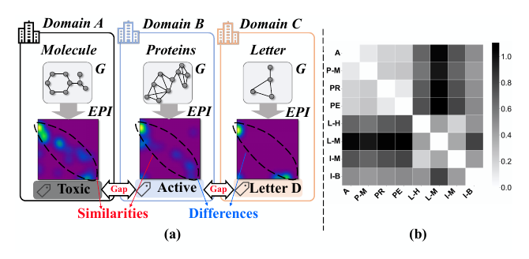
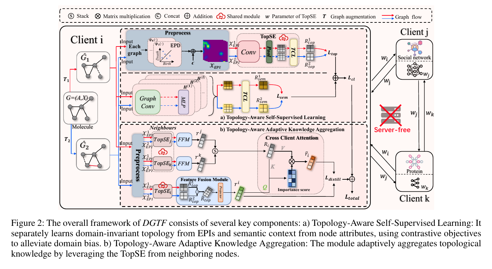

# DGTF: Cross-Domain Decentralized Graph Learning with Topology-Aware Knowledge Fusion

[](https://ojs.aaai.org/index.php/AAAI/article/view/40118)

[Paper](https://ojs.aaai.org/index.php/AAAI/article/view/40118) · [DOI 10.1609/aaai.v40i34.40118](https://doi.org/10.1609/aaai.v40i34.40118)

Ruisheng Zheng, Mingyi Li, Xiao Zhang, Hongjian Shi, Yanjie Fu, Yuan Yuan, and Dongxiao Yu. *Proceedings of the AAAI Conference on Artificial Intelligence*, vol. 40, no. 34, pp. 28839–28847, 2026.



*(a) Molecule, protein, and letter graphs mapped to extended persistence images, with shared topology and domain gaps. (b) Pairwise MMD of those images on eight cross-domain datasets.*

## Overview

Cross-domain decentralized graph learning lets parties collaborate without sharing raw graphs. Inconsistent labels and topology shift across domains make ordinary parameter averaging a poor fit, especially when client models differ. DGTF uses extended persistent homology to measure that shift, then transfers task-agnostic topology with contrastive learning and a model-independent fusion step. Each TUDataset in a run is one client.



*Figure 2.* Local contrastive learning on persistence images and node features, then server-free fusion of the topology encoder.

## Installation

Python 3.9. `requirements.txt` pulls `torch==2.4.0+cu124` from the CUDA 12.4 index.

```bash
python3.9 -m venv .venv
source .venv/bin/activate
python -m pip install --upgrade pip
pip install -r requirements.txt
```

## Quick Start

Raw TU files are already in `Data1/TUDataset`. `--data_group` is `sm` (default), `bio`, `sn`, `cv`, `sm-bio`, `sm-bio-cv`, or `sm-bio-cv-sn`.

```bash
python main.py
python main.py --data_group sm-bio
python main.py --data_group sm-bio-cv-sn
```

| Flag | Default | Meaning |
| --- | --- | --- |
| `--data_group` | `sm` | Which datasets share the run |
| `--device` | `cuda:0` | Training device |
| `--num_rounds` | `200` | Communication rounds |
| `--seed` | `789` | Random seed and train/test split |
| `--tensor_layer_type` | `TCL` | `TCL` or `TRL` |

Accuracy CSV files and TensorBoard logs are written under `outputs/raw/`.

## Results

Peak accuracy and macro-F1 from Table 1 of the [paper](https://ojs.aaai.org/index.php/AAAI/article/view/40118), averaged over clients. FedStar+FedMRL and FedSSP+MH-pFLID are the FedStar and FedSSP rows with the highest accuracy when those four settings are averaged. Full comparisons and ablations are in the paper.

| Method | SM ACC | SM F1 | SM-BIO ACC | SM-BIO F1 | SM-BIO-CV ACC | SM-BIO-CV F1 | SM-BIO-CV-SN ACC | SM-BIO-CV-SN F1 |
| --- | --- | --- | --- | --- | --- | --- | --- | --- |
| FedStar+FedMRL | 78.04 | 70.67 | 77.74 | 71.72 | 77.31 | 72.12 | 75.50 | 70.45 |
| FedSSP+MH-pFLID | 80.44 | 73.85 | 78.05 | 74.83 | 77.14 | 71.32 | 74.00 | 70.11 |
| **DGTF** | **82.64** | **75.72** | **83.39** | **76.29** | **78.77** | **72.48** | **76.48** | **70.65** |

## Citation

```bibtex
@inproceedings{zheng2026dgtf,
  title     = {DGTF: Cross-Domain Decentralized Graph Learning with Topology-Aware Knowledge Fusion},
  author    = {Zheng, Ruisheng and Li, Mingyi and Zhang, Xiao and Shi, Hongjian and Fu, Yanjie and Yuan, Yuan and Yu, Dongxiao},
  booktitle = {Proceedings of the AAAI Conference on Artificial Intelligence},
  volume    = {40},
  number    = {34},
  pages     = {28839--28847},
  year      = {2026},
  doi       = {10.1609/aaai.v40i34.40118},
  url       = {https://ojs.aaai.org/index.php/AAAI/article/view/40118}
}
```

## Acknowledgements

Our implementation builds upon FedStar and FedSSP. We thank the authors for releasing their code.

- FedStar: [Federated Learning on Non-IID Graphs via Structural Knowledge Sharing](https://ojs.aaai.org/index.php/AAAI/article/view/26187), AAAI 2023. [arXiv:2211.13009](https://arxiv.org/abs/2211.13009). Code: [yuetan031/FedStar](https://github.com/yuetan031/FedStar).
- FedSSP: [FedSSP: Federated Graph Learning with Spectral Knowledge and Personalized Preference](https://proceedings.neurips.cc/paper_files/paper/2024/hash/3d226fb8fbd6ee6ec70d0427f1319707-Abstract-Conference.html), NeurIPS 2024. [arXiv:2410.20105](https://arxiv.org/abs/2410.20105). Code: [OakleyTan/FedSSP](https://github.com/OakleyTan/FedSSP).

## License

[MIT](LICENSE). Copyright (c) 2026 Ruisheng Zheng, Mingyi Li, Xiao Zhang, Hongjian Shi, Yanjie Fu, Yuan Yuan, and Dongxiao Yu.
